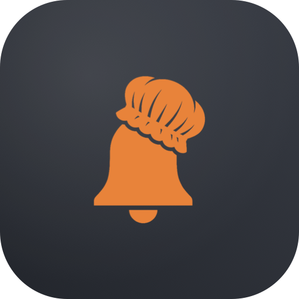
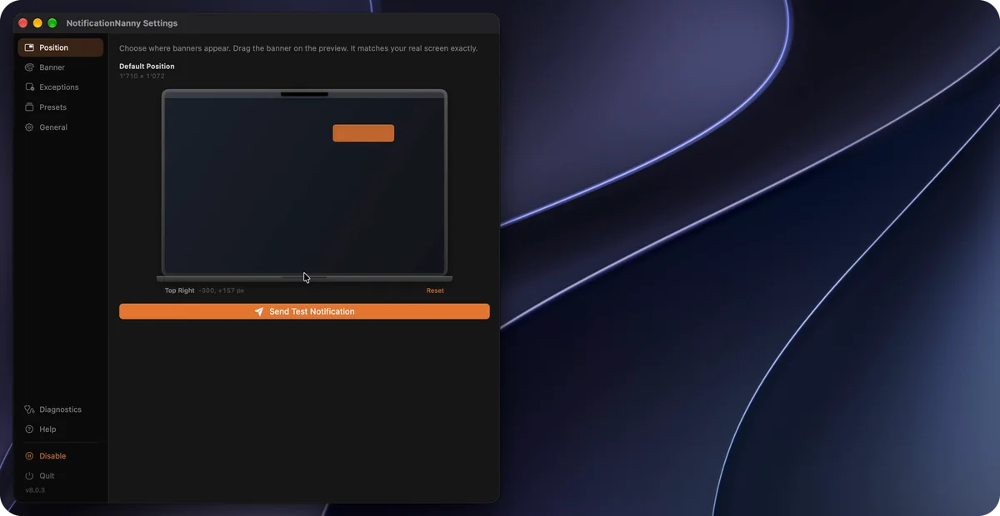
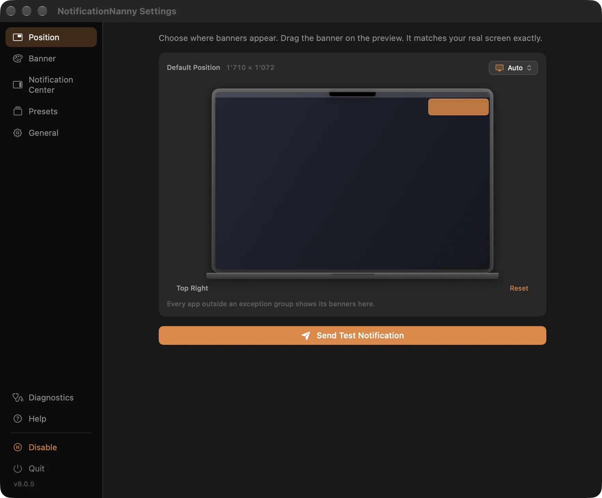
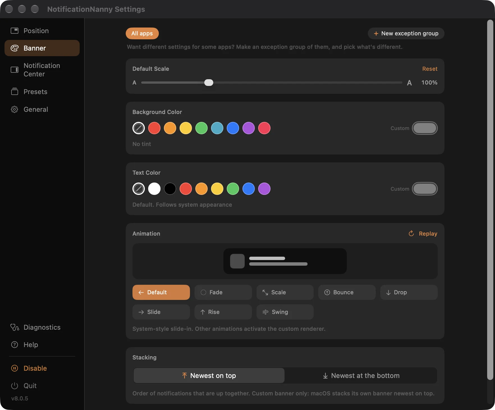
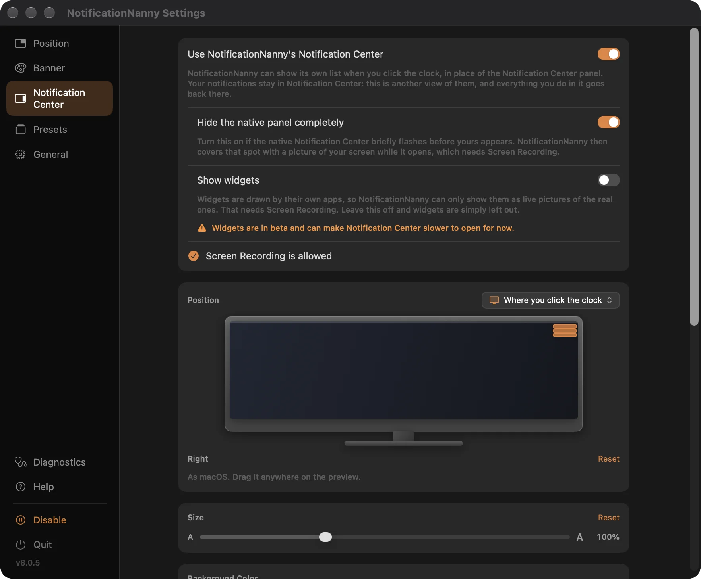

  

<h1 align="center">NotificationNanny</h1>

  Position, scale, tint, and animate notification banners, globally or per app. 
  And a Notification Center of your own. For macOS 14 and newer, including macOS 27.

  <a href="https://github.com/chessper53/NotificationNanny/releases/latest"><b>Download for macOS</b></a> ·
  <a href="https://chessper53.github.io/NotificationNanny/">Website</a> ·
  <a href="https://github.com/chessper53/NotificationNanny/releases">What's new</a> ·
  <a href="https://github.com/chessper53/NotificationNanny/issues">Report an issue</a>

  
  
  

 

  

 

## Install

**With Homebrew**

    brew tap chessper53/notificationnanny https://github.com/chessper53/NotificationNanny
    brew install --cask notificationnanny

Click the bell icon in your menu bar and grant Accessibility permission. Update later with
`brew update && brew upgrade --cask notificationnanny`.

If you installed before 8.0.5 and `brew update` shows an error for this tap, run this once:

    git -C "$(brew --repo chessper53/notificationnanny)" fetch origin
    git -C "$(brew --repo chessper53/notificationnanny)" reset --hard origin/main

**Manually**

1. Download the [latest release](https://github.com/chessper53/NotificationNanny/releases/latest) and open the zip.
2. Drag NotificationNanny.app into Applications and launch it.
3. Click the bell icon in your menu bar and grant Accessibility permission.

## What it does

- Drag banners anywhere on a live preview of your screen, with separate positions for each display, or let them follow your cursor.
- Scale banners from 50% to 250%, tint the background or text, pick an animation, or blur the text for privacy.
- Group apps and give each group its own position, screen, size, tint and animation.
- Close banners after 1 to 300 seconds, hold them while your display sleeps, and pause them during Focus or screen sharing.
- Reply right in a custom banner, which keeps the app's own buttons.
- Click the clock for a Notification Center of your own. It copies the system's and uses your colours, and you choose its size, side and screen. It can filter by app and show your widgets too.
- Save up to 5 presets, switch between them in one click, and back up or import your settings.
- App support in English, French, Spanish, German and Italian.

  
  
  

## Issues and feature requests

Found a bug or have an idea? [Open an issue](https://github.com/chessper53/NotificationNanny/issues).
I work on this alongside a full time job, so replies can take a little while, but I read every issue.

## Support the project

If NotificationNanny makes your day a little quieter, please star this repo.

## Privacy

NotificationNanny collects nothing. No data leaves your Mac and nothing is stored anywhere else.

- **Accessibility** is used only to observe and move notification windows on your machine.
- **Screen Recording** is only requested if you turn on widgets or "Hide the native panel completely" in the custom Notification Center. It is used only to show those widgets and to cover the native panel while it opens. The pictures stay in memory and are never saved or sent anywhere.

## How it works

NotificationNanny uses the macOS Accessibility API to watch the Notification Center process. When
a banner appears, the app moves or replaces it according to your rules. For scaled, tinted or custom
banners, it moves the system banner off screen and shows its own window in the macOS banner style.

The custom Notification Center works the same way. The real panel stays open off screen,
NotificationNanny draws its own list from it, and every click and reply goes back to the real panel.

This relies on private macOS internals, so any OS update can change how it behaves. The app sandbox
is turned off because Accessibility access to other processes does not work inside it.

## License

Released under the [MIT License](https://github.com/chessper53/NotificationNanny/blob/main/LICENSE).
